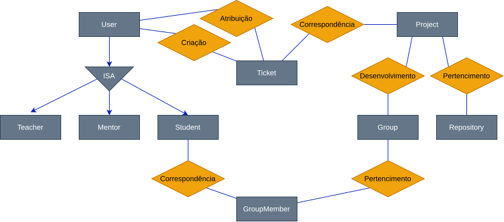
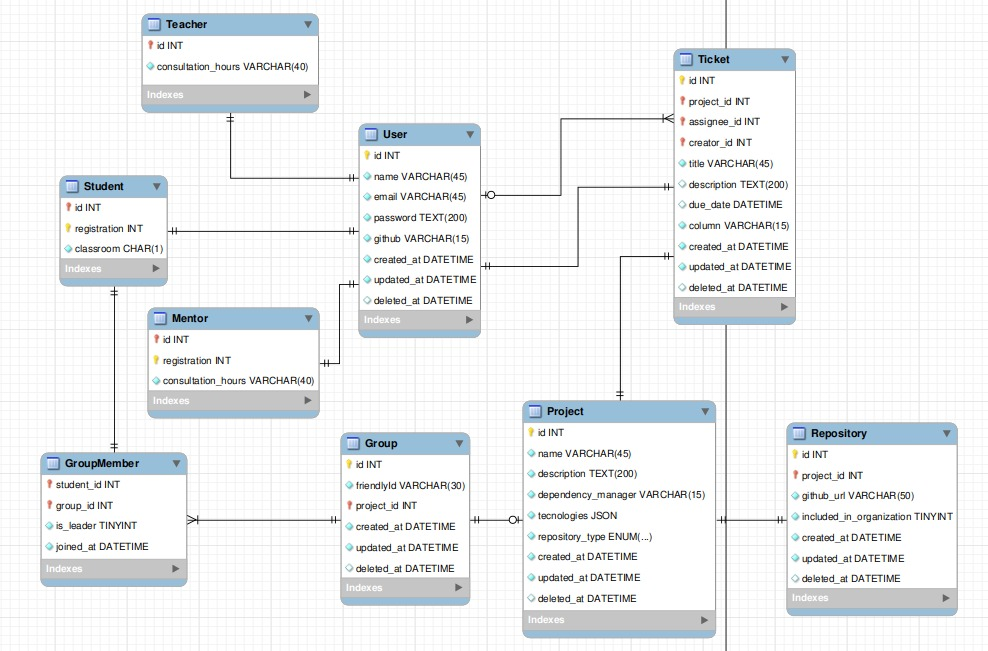

# C07 - CarecaHub

### **INTEGRANTES DO TRIO**

| Nome                                | Matrícula | Curso | GitHub          |
|-------------------------------------|-----------|-------|-----------------|
| Felipe Soares                       | 843       | GES   | Felipe-SSS      |
| Daniel Granato Botelho Poscidonio   | 792       | GES   | Granato07       |
| Pedro de Souza Labastie             | 2172      | GEC   | PedroLabastie   |

---

### Qual a ideia por trás do CarecaHub?

O **CarecaHub** tem como ideia central organizar e acompanhar projetos acadêmicos de desenvolvimento de software, reunindo informações que normalmente ficam dispersas entre planilhas e repositórios. A proposta é facilitar a organização dos alunos e o acompanhamento por professores e monitores, centralizando a composição dos grupos, os dados dos projetos e as tarefas a serem realizadas.

Essa ideia é representada por um modelo com usuários e suas especializações em alunos, professores e monitores. A participação dos alunos nos grupos é registrada com a indicação de liderança e a data de ingresso, e os grupos podem ser vinculados a projetos. Os projetos reúnem descrição, tecnologias, gerenciador de dependências e tipo de repositório, além de vínculos com repositórios e tickets. Cada ticket registra uma tarefa do projeto, com título, descrição, prazo, coluna de acompanhamento, usuário criador e um possível usuário responsável.

  

 

  

## Banco de Dados

Para criar e popular o banco MySQL do projeto, incluindo a ordem de execução dos scripts e os relacionamentos entre as tabelas, consulte o [guia de banco de dados](sql/README.md).
