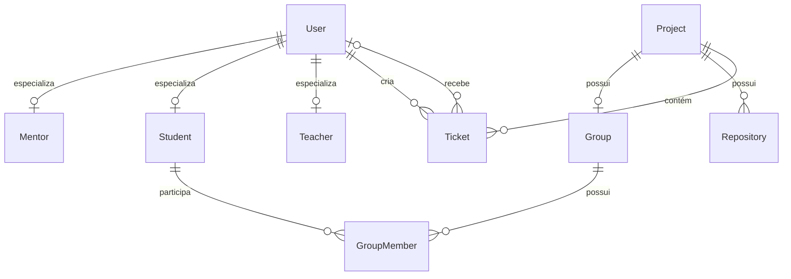

# Banco de Dados CarecaHub

O banco `carecahub` centraliza usuários, seus papéis acadêmicos, projetos, grupos, repositórios e tickets. Os arquivos `INSERT_*.sql` criam uma procedure reutilizável para cada entidade, executam uma massa demonstrativa e a removem ao terminar. Assim, cada arquivo pode ser estudado ou executado separadamente, sem deixar procedures auxiliares no schema.



## Entidades

| Entidade | Chave e campos principais | Dependências |
|---|---|---|
| `User` | `id`, nome, e-mail, GitHub e datas | — |
| `Mentor` | `id`, matrícula, horário de atendimento | `User` |
| `Student` | `id`, matrícula, turma | `User` |
| `Teacher` | `id`, horário de atendimento | `User` |
| `Project` | `id`, nome, tecnologias JSON e tipo de repositório | — |
| `Group` | `id`, `friendlyId`, `project_id` | `Project` |
| `Repository` | `id`, URL GitHub, organização e `project_id` | `Project` |
| `Ticket` | `id`, projeto, criador, responsável, coluna e prazo | `Project`, `User` |
| `GroupMember` | `student_id`, `group_id`, liderança e data de entrada | `Student`, `Group` |

## Criar o banco

Requer MySQL 8 ou superior. A partir deste diretório, crie o schema e as tabelas:

```bash
mysql -u <usuario> -p < CREATE_SCHEMA_AND_TABLES.sql
```

Para recriar o banco do zero, execute antes ``DROP SCHEMA IF EXISTS `carecahub`;`` em um cliente MySQL e depois execute `CREATE_SCHEMA_AND_TABLES.sql`. Esse comando apaga todos os dados da base. A carga não deve ser executada duas vezes sobre a mesma base, pois e-mails, matrículas e relações possuem restrições de unicidade.

## Popular o banco

### Carga completa (recomendada)

Ainda no diretório `sql`, execute o orquestrador:

```bash
mysql -u <usuario> -p < RUN_ALL_INSERTS.sql
```

`RUN_ALL_INSERTS.sql` usa o comando `SOURCE`, suportado pelo cliente `mysql`, e deve ser executado a partir deste diretório para encontrar os arquivos individuais.

### Carga por etapa

Também é possível executar os scripts individualmente. Use esta ordem para respeitar todas as foreign keys:

| Ordem | Arquivo | Entidade | Depende de |
|---:|---|---|---|
| 1 | `INSERT_USERS.sql` | `User` | — |
| 2 | `INSERT_MENTORS.sql` | `Mentor` | `User` |
| 3 | `INSERT_STUDENTS.sql` | `Student` | `User` |
| 4 | `INSERT_TEACHERS.sql` | `Teacher` | `User` |
| 5 | `INSERT_PROJECTS.sql` | `Project` | — |
| 6 | `INSERT_GROUPS.sql` | `Group` | `Project` |
| 7 | `INSERT_REPOSITORIES.sql` | `Repository` | `Project` |
| 8 | `INSERT_TICKETS.sql` | `Ticket` | `Project`, `User` |
| 9 | `INSERT_GROUP_MEMBERS.sql` | `GroupMember` | `Student`, `Group` |

Exemplo de execução de uma etapa:

```bash
mysql -u <usuario> -p < INSERT_USERS.sql
```

Cada procedure é chamada pelo próprio arquivo. Os valores de IDs usados pelas especializações e relacionamentos correspondem à massa criada pelos scripts anteriores; por isso, em uma instalação nova, siga a sequência apresentada.
