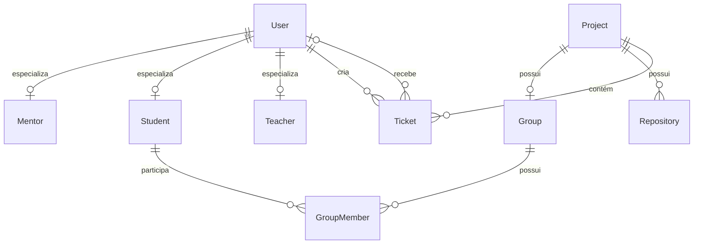

# Banco de Dados CarecaHub

O banco `carecahub` centraliza usuários, seus papéis acadêmicos, projetos, grupos, repositórios e tickets. Os arquivos `INSERT_*.sql` criam uma procedure reutilizável para cada entidade, executam uma massa demonstrativa e a removem ao terminar. Assim, cada arquivo pode ser estudado ou executado separadamente, sem deixar procedures auxiliares no schema.



## Entidades

| Entidade | Chave e campos principais | Dependências |
|---|---|---|
| `User` | `id`, nome, e-mail, GitHub e datas | — |
| `Mentor` | `id`, matrícula, horário de atendimento | `User` |
| `Student` | `id`, matrícula, turma | `User` |
| `Teacher` | `id`, horário de atendimento | `User` |
| `Project` | `id`, nome, tecnologias JSON e tipo de repositório | — |
| `Group` | `id`, `friendlyId`, `project_id` | `Project` |
| `Repository` | `id`, URL GitHub, organização e `project_id` | `Project` |
| `Ticket` | `id`, projeto, criador, responsável, coluna e prazo | `Project`, `User` |
| `GroupMember` | `student_id`, `group_id`, liderança e data de entrada | `Student`, `Group` |

## Tutorial: executar manualmente no MySQL Workbench

Use este fluxo quando quiser abrir e executar cada arquivo individualmente pela interface do MySQL Workbench. Ele não depende do comando `SOURCE` do cliente de linha de comando.

1. Abra o MySQL Workbench e conecte-se à instância MySQL.
2. Selecione **File > Open SQL Script** e abra `CREATE_SCHEMA_AND_TABLES.sql`.
3. Execute o arquivo inteiro pelo botão de raio (**Execute**). Isso cria e seleciona o schema `carecahub`.
4. Abra e execute os scripts de carga abaixo, **um por vez e nesta ordem**. Cada script já contém `USE carecahub` e chama sua própria procedure de inserção.

| Ordem | Arquivo a executar | Motivo da ordem |
|---:|---|---|
| 1 | `INSERT_USERS.sql` | Cria os usuários referenciados pelas especializações e tickets. |
| 2 | `INSERT_MENTORS.sql` | Depende de `User`. |
| 3 | `INSERT_STUDENTS.sql` | Depende de `User`. |
| 4 | `INSERT_TEACHERS.sql` | Depende de `User`. |
| 5 | `INSERT_PROJECTS.sql` | Cria os projetos referenciados por grupos, repositórios e tickets. |
| 6 | `INSERT_GROUPS.sql` | Depende de `Project`. |
| 7 | `INSERT_REPOSITORIES.sql` | Depende de `Project`. |
| 8 | `INSERT_TICKETS.sql` | Depende de `Project` e `User`. |
| 9 | `INSERT_GROUP_MEMBERS.sql` | Depende de `Student` e `Group`. |

5. Para instalar os objetos permanentes, abra e execute, nesta ordem: `TRIGGERS_GROUP_LEADER.sql`, `FUNCTION_TICKET_COUNT.sql`, `VIEW_GROUP_SUMMARY.sql`, `VIEW_PROJECT_DASHBOARD.sql`, `VIEW_USER_WORKLOAD.sql` e `VIEW_TICKET_BOARD.sql`.
6. Opcionalmente, execute os scripts de demonstração:
   - `TEST_FUNCTION_TICKET_COUNT.sql` valida a function;
   - `TEST_TRIGGER_GROUP_LEADER.sql` deve exibir o erro esperado de segundo líder;
   - `DELETE_GROUP_MEMBER.sql` demonstra uma exclusão e a desfaz com `ROLLBACK`;
   - `UPDATE_TICKET_ATRIBUTION.sql` altera permanentemente a atribuição de um ticket da massa de exemplo.

Para recomeçar, execute `DROP SCHEMA IF EXISTS carecahub;` em uma nova aba SQL e retorne ao passo 2. Isso apaga todas as tabelas e dados do projeto.

## Tutorial: executar scrips através do terminal com mysql

### Criar o banco

Requer MySQL 8 ou superior. A partir deste diretório, crie o schema e as tabelas:

```bash
mysql -u <usuario> -p < CREATE_SCHEMA_AND_TABLES.sql
```

Para recriar o banco do zero, execute antes ``DROP SCHEMA IF EXISTS `carecahub`;`` em um cliente MySQL e depois execute `CREATE_SCHEMA_AND_TABLES.sql`. Esse comando apaga todos os dados da base. A carga não deve ser executada duas vezes sobre a mesma base, pois e-mails, matrículas e relações possuem restrições de unicidade.

### Popular o banco

### Carga completa (recomendada)

Ainda no diretório `mysql`, execute o orquestrador:

```bash
mysql -u <usuario> -p < RUN_ALL_INSERTS.sql
```

`RUN_ALL_INSERTS.sql` usa o comando `SOURCE`, suportado pelo cliente `mysql`, e deve ser executado a partir deste diretório para encontrar os arquivos individuais.

### Carga por etapa

Também é possível executar os scripts individualmente. Use esta ordem para respeitar todas as foreign keys:

| Ordem | Arquivo | Entidade | Depende de |
|---:|---|---|---|
| 1 | `INSERT_USERS.sql` | `User` | — |
| 2 | `INSERT_MENTORS.sql` | `Mentor` | `User` |
| 3 | `INSERT_STUDENTS.sql` | `Student` | `User` |
| 4 | `INSERT_TEACHERS.sql` | `Teacher` | `User` |
| 5 | `INSERT_PROJECTS.sql` | `Project` | — |
| 6 | `INSERT_GROUPS.sql` | `Group` | `Project` |
| 7 | `INSERT_REPOSITORIES.sql` | `Repository` | `Project` |
| 8 | `INSERT_TICKETS.sql` | `Ticket` | `Project`, `User` |
| 9 | `INSERT_GROUP_MEMBERS.sql` | `GroupMember` | `Student`, `Group` |

Exemplo de execução de uma etapa:

```bash
mysql -u <usuario> -p < INSERT_USERS.sql
```

Cada procedure é chamada pelo próprio arquivo. Os valores de IDs usados pelas especializações e relacionamentos correspondem à massa criada pelos scripts anteriores; por isso, em uma instalação nova, siga a sequência apresentada.

## Objetos adicionais e consultas de demonstração

Depois da carga completa, os arquivos abaixo podem ser executados conforme a necessidade. Os triggers, a function e a view permanecem no schema; os scripts de teste e de consulta apenas executam operações ou exibem resultados.

| Arquivo | Tipo | Efeito e pré-requisito |
|---|---|---|
| `TRIGGERS_GROUP_LEADER.sql` | Triggers | Instala as regras de um único líder por grupo. Requer a tabela `GroupMember`. |
| `TEST_TRIGGER_GROUP_LEADER.sql` | Teste de trigger | Tenta promover um segundo líder no grupo `1`; requer a carga completa e os triggers instalados. |
| `FUNCTION_TICKET_COUNT.sql` | Function | Cria `function_project_ticket_count`; requer as tabelas `Project` e `Ticket`. |
| `TEST_FUNCTION_TICKET_COUNT.sql` | Consultas de teste | Valida a function contra a massa demonstrativa. Requer a function e a carga completa. |
| `VIEW_GROUP_SUMMARY.sql` | View | Cria `view_group_summary`; usa grupos, membros, estudantes, usuários, projetos e repositórios. |
| `VIEW_PROJECT_DASHBOARD.sql` | View | Cria `view_project_dashboard`; consolida grupo, equipe, repositórios e tickets por projeto. |
| `VIEW_USER_WORKLOAD.sql` | View | Cria `view_user_workload`; consolida papéis, grupos, tickets criados e carga de tickets atribuídos por usuário. |
| `VIEW_TICKET_BOARD.sql` | View | Cria `view_ticket_board`; lista tickets com projeto, grupo, líder, criador, responsável e situação do prazo. |
| `UPDATE_TICKET_ATRIBUTION.sql` | Atualização e consulta | Reatribui um ticket da massa demonstrativa e mostra o novo responsável. Altera dados persistentemente. |
| `DELETE_GROUP_MEMBER.sql` | Transação e consultas | Demonstra a exclusão de um membro, mas restaura os dados com `ROLLBACK`. |

Execute cada arquivo a partir deste diretório com o cliente MySQL:

```bash
mysql -u <usuario> -p < NOME_DO_ARQUIVO.sql
```

Uma sequência útil em uma instalação nova é: criar o schema, executar `RUN_ALL_INSERTS.sql`, instalar `TRIGGERS_GROUP_LEADER.sql`, criar a function e a view, e então executar os scripts de teste ou consulta desejados.

## Triggers: um único líder por grupo

`TRIGGERS_GROUP_LEADER.sql` cria dois triggers permanentes na tabela `GroupMember`:

- `trigger_validate_group_leader_insert`, executado antes de um `INSERT`;
- `trigger_validate_group_leader_update`, executado antes de um `UPDATE`.

Quando `is_leader` recebe `1`, ambos contam os líderes existentes no mesmo `group_id`. Se já houver um, a operação é interrompida com `SQLSTATE '45000'` e a mensagem `Este grupo ja possui um lider cadastrado.`. Isso protege a regra de negócio tanto na inclusão quanto na promoção de um membro existente.

Instale-os uma vez:

```bash
mysql -u <usuario> -p < TRIGGERS_GROUP_LEADER.sql
```

O arquivo não remove triggers já existentes. Para recriá-los, remova-os manualmente com `DROP TRIGGER IF EXISTS` antes de executar o arquivo novamente.

### Testar os triggers

`TEST_TRIGGER_GROUP_LEADER.sql` primeiro mostra os membros do grupo `1` e depois tenta tornar o estudante `3` líder, embora a massa já tenha um líder nesse grupo. A atualização deve falhar com o erro `1644` e a mensagem definida pelo trigger; ela não altera os dados.

```bash
mysql -u <usuario> -p < TEST_TRIGGER_GROUP_LEADER.sql
```

## Procedures: carga de dados por entidade

As procedures são aplicadas nos nove arquivos `INSERT_*.sql` para encapsular a inserção de cada entidade. Cada arquivo segue o mesmo ciclo: remove uma procedure homônima que possa ter restado de uma execução anterior, cria a procedure com parâmetros `IN`, executa os `CALL`s da massa demonstrativa e remove a procedure ao final.

| Arquivo | Procedure | Entidade inserida |
|---|---|---|
| `INSERT_USERS.sql` | `sp_insert_user` | `User` |
| `INSERT_MENTORS.sql` | `sp_insert_mentor` | `Mentor` |
| `INSERT_STUDENTS.sql` | `sp_insert_student` | `Student` |
| `INSERT_TEACHERS.sql` | `sp_insert_teacher` | `Teacher` |
| `INSERT_PROJECTS.sql` | `sp_insert_project` | `Project` |
| `INSERT_GROUPS.sql` | `sp_insert_group` | `Group` |
| `INSERT_REPOSITORIES.sql` | `sp_insert_repository` | `Repository` |
| `INSERT_TICKETS.sql` | `sp_insert_ticket` | `Ticket` |
| `INSERT_GROUP_MEMBERS.sql` | `sp_insert_group_member` | `GroupMember` |

Esse padrão deixa explícitos os campos necessários a cada inserção e evita repetir a instrução `INSERT INTO` para cada registro da massa. Por exemplo, `sp_insert_ticket` recebe projeto, responsável, criador, título, descrição, prazo, coluna e datas; os `CALL`s variam somente os valores.

As procedures de carga são temporárias por decisão do projeto: ao término de cada arquivo, `DROP PROCEDURE IF EXISTS` as remove do schema. Assim, os dados permanecem nas tabelas, mas as procedures não ficam disponíveis para uso posterior. Para inserir novos dados na aplicação, use a API ou um `INSERT` apropriado; para estudar a rotina, abra o arquivo `INSERT_*.sql` correspondente.

## Selects: consultas aplicadas no projeto

Os `SELECT`s foram usados para consultar a massa, validar regras de negócio e comprovar o efeito de operações antes e depois de elas ocorrerem. Eles não criam objetos permanentes no banco.

| Arquivo | Como o `SELECT` é aplicado |
|---|---|
| `TEST_TRIGGER_GROUP_LEADER.sql` | Mostra os membros do grupo antes de tentar violar a regra de líder único. |
| `DELETE_GROUP_MEMBER.sql` | Mostra os membros antes da exclusão, durante a transação e após o `ROLLBACK`. |
| `UPDATE_TICKET_ATRIBUTION.sql` | Consulta o responsável anterior e, após o `UPDATE`, usa `LEFT JOIN` com `User` para mostrar o nome do novo responsável. |
| `TEST_FUNCTION_TICKET_COUNT.sql` | Consulta o retorno da function por projeto, lista todos os projetos e compara a function a um `COUNT(*)` correlacionado. |
| `VIEW_GROUP_SUMMARY.sql` | Define a consulta reutilizável da view; depois de criada, ela é consumida por `SELECT * FROM view_group_summary`. |
| `VIEW_PROJECT_DASHBOARD.sql` | Agrega equipe, repositórios e tickets com subconsultas por projeto, evitando duplicação causada pelos relacionamentos 1:N. |
| `VIEW_USER_WORKLOAD.sql` | Consolida grupos, tickets criados e tickets atribuídos em agregações separadas antes de uni-las ao usuário. |
| `VIEW_TICKET_BOARD.sql` | Usa `JOIN`s entre ticket, projeto, grupo, criador, responsável e líder do grupo para formar uma linha completa por ticket. |

Exemplos de consultas de leitura disponíveis após a carga e a criação dos objetos:

```sql
-- Tickets ativos por projeto, usando a function.
SELECT p.id, p.name, function_project_ticket_count(p.id) AS active_tickets
FROM Project p
WHERE p.deleted_at IS NULL;

-- Resumo agregado de grupos, usando a view.
SELECT * FROM view_group_summary;
```

Os scripts que contêm `UPDATE` ou `DELETE` sempre usam `SELECT` como verificação: `UPDATE_TICKET_ATRIBUTION.sql` persiste a reatribuição, enquanto `DELETE_GROUP_MEMBER.sql` encerra com `ROLLBACK` e preserva a massa original.

## Consultas de alteração de dados

### Reatribuir um ticket

`UPDATE_TICKET_ATRIBUTION.sql` localiza o ticket `Criar API de tickets` do projeto `1`, define seu `assignee_id` como `2`, atualiza `updated_at` com `NOW()` e lista o responsável após a alteração. Na massa criada por `INSERT_TICKETS.sql`, esse ticket começa atribuído ao usuário `3`; portanto, este script **modifica o banco de forma persistente**.

```bash
mysql -u <usuario> -p < UPDATE_TICKET_ATRIBUTION.sql
```

Use-o apenas em uma base de demonstração ou restaure a atribuição manualmente caso precise retornar à massa original.

### Simular a remoção de um membro

`DELETE_GROUP_MEMBER.sql` lista os membros do grupo `1`, remove temporariamente o estudante `3`, exibe o estado durante a transação e executa `ROLLBACK`. A última consulta confirma a restauração. Portanto, o arquivo demonstra `START TRANSACTION`, `DELETE` e `ROLLBACK`, mas **não deixa nenhuma exclusão persistida**.

```bash
mysql -u <usuario> -p < DELETE_GROUP_MEMBER.sql
```

## Function: contagem de tickets por projeto

Os arquivos `FUNCTION_TICKET_COUNT.sql` e `TEST_FUNCTION_TICKET_COUNT.sql` tratam da function `function_project_ticket_count(p_project_id)`. Ela recebe o id de um projeto e devolve quantos tickets ativos ele possui. Um ticket é ativo quando `deleted_at` é nulo, então tickets removidos logicamente não entram na contagem.

```sql
SELECT function_project_ticket_count(1) AS total_tickets;
```

Ela também pode ser usada dentro de uma consulta maior, por exemplo para listar todos os projetos com a quantidade de tickets de cada um:

```sql
SELECT p.id, p.name, function_project_ticket_count(p.id) AS active_tickets
FROM Project p
WHERE p.deleted_at IS NULL;
```

A vantagem é concentrar em um só lugar a regra de contagem com o filtro de remoção lógica, em vez de repetir o `COUNT(*)` em várias consultas. Diferente dos scripts `INSERT_*.sql`, a function permanece no schema depois da execução.

O arquivo de teste faz cinco verificações: três consultas individuais (projetos 1, 2 e 3, com 2 tickets cada na massa de dados), uma listagem de todos os projetos e uma comparação entre o resultado da function e um `COUNT(*)` direto, cujas duas colunas devem ser iguais. Execute-o depois da carga completa e de `FUNCTION_TICKET_COUNT.sql`.

## View: resumo dos grupos

O arquivo `VIEW_GROUP_SUMMARY.sql` cria a view `view_group_summary`, que mostra os dados principais de cada grupo em uma única consulta:

- `group_id`: id do grupo.
- `group_name`: identificador amigável do grupo (`friendlyId`).
- `leader_name`: nome do líder, ou `NULL` se o grupo ainda não tiver líder.
- `member_count`: quantidade de membros do grupo.
- `project_name`: nome do projeto associado, ou `NULL` se o grupo não tiver projeto.
- `repository_count`: quantidade de repositórios do projeto do grupo.

```sql
SELECT * FROM view_group_summary;
```

Ela evita reescrever os JOINs entre `Group`, `GroupMember`, `Student`, `User`, `Project` e `Repository` sempre que for preciso listar os grupos. Como usa `LEFT JOIN`, grupos sem membros ou sem projeto continuam aparecendo, e `COUNT(DISTINCT ...)` impede que membros e repositórios sejam contados em duplicidade. Para ver dados úteis, execute-a depois da carga completa.

## View: painel de projetos

`VIEW_PROJECT_DASHBOARD.sql` cria a view `view_project_dashboard`, voltada a uma visão gerencial por projeto. Ela relaciona `Project` ao seu grupo, equipe, repositórios e tickets ativos sem transformar cada repositório ou ticket em uma linha adicional do resultado.

- Dados do projeto: identificador, nome, gerenciador de dependências e tipo de repositório.
- Dados do grupo: identificador, nome amigável, líder e quantidade de membros.
- Indicadores: quantidade de repositórios, tickets ativos, tickets abertos, tickets atrasados e próximo prazo.

Os relacionamentos de muitos repositórios e tickets por projeto são agregados em subconsultas antes dos `LEFT JOIN`s finais. Isso impede que um projeto com vários repositórios e tickets tenha suas contagens multiplicadas.

```bash
mysql -u <usuario> -p < VIEW_PROJECT_DASHBOARD.sql
```

```sql
SELECT *
FROM view_project_dashboard
ORDER BY overdue_ticket_count DESC, next_due_date;
```

## View: carga de trabalho por usuário

`VIEW_USER_WORKLOAD.sql` cria a view `view_user_workload`, que organiza uma visão de pessoas sem expor o campo de senha. Ela usa `LEFT JOIN`s para manter usuários mesmo sem grupos ou tickets e identifica o papel principal entre mentor, professor, estudante ou usuário sem especialização.

- Participação acadêmica: grupos, grupos liderados e lista de identificadores amigáveis dos grupos.
- Atividade de tickets: quantidade criada, atribuída, aberta, atrasada e última atualização de ticket atribuído.
- Dados públicos: identificador, nome, e-mail e GitHub.

As métricas de grupos, tickets criados e tickets atribuídos são calculadas em subconsultas separadas. Essa estratégia evita um produto cartesiano quando um usuário participa de mais de um grupo e também possui vários tickets.

```bash
mysql -u <usuario> -p < VIEW_USER_WORKLOAD.sql
```

```sql
SELECT user_name, groups, open_assigned_ticket_count, overdue_assigned_ticket_count
FROM view_user_workload
ORDER BY overdue_assigned_ticket_count DESC, open_assigned_ticket_count DESC;
```

## View: quadro de tickets

`VIEW_TICKET_BOARD.sql` cria a view `view_ticket_board`, adequada para uma tela de acompanhamento de tarefas. Cada linha representa um ticket ativo e reúne seu projeto, grupo, líder do grupo, criador e responsável atual.

- `due_status` é calculado em tempo de consulta: `Sem prazo`, `Concluído`, `Atrasado` ou `No prazo`.
- Um ticket sem responsável continua presente, pois a associação com o responsável usa `LEFT JOIN`.
- O líder do grupo é obtido em uma subconsulta agregada, mantendo uma linha por ticket mesmo que dados históricos inválidos contenham mais de um líder.

```bash
mysql -u <usuario> -p < VIEW_TICKET_BOARD.sql
```

```sql
SELECT ticket_column, title, project_name, assignee_name, due_status
FROM view_ticket_board
ORDER BY due_date IS NULL, due_date, ticket_id;
```
